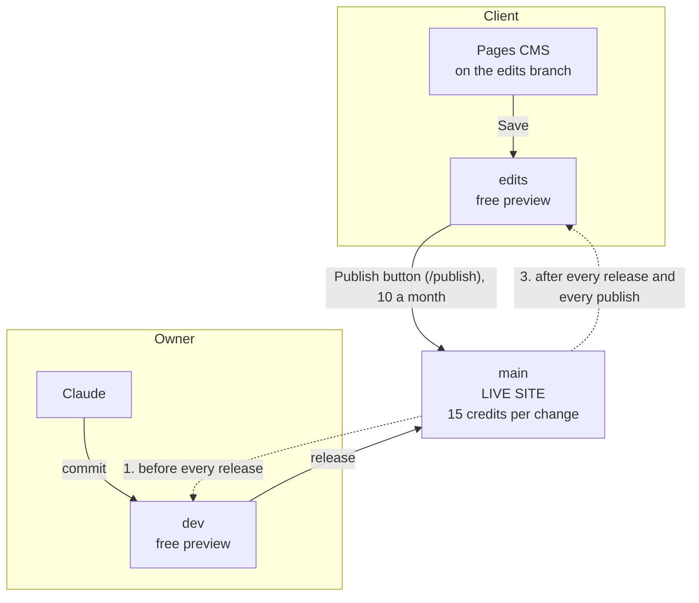
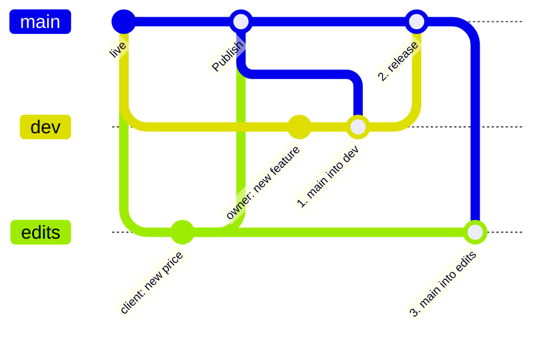

# Client editing kit

Lets a client change prices, photos and events themselves, without the owner, while keeping
live deploys (15 Netlify credits each) under a monthly cap. First built on `rolling-spanner`
(October 2026). The `client-editing` skill in `skills/` tells Claude how to add it to a site;
this page is the reference for the owner.

## How it works

Two people, three copies of the site.

| Branch | Who | Address | Cost to build |
| --- | --- | --- | --- |
| `edits` | the client, through Pages CMS | `https://edits--<site>.netlify.app` | free (branch deploy) |
| `dev` | the owner, through Claude | `https://dev--<site>.netlify.app` | free (branch deploy) |
| `main` | everyone: the live site | the site's domain | 15 credits per change |

### The client's cycle

1. Open Pages CMS on `edits`, change things, **Save** (as often as they like; every save is a
   commit, so anything can be undone).
2. Check the `edits` preview a couple of minutes later.
3. On `/publish`, enter the password and press **Publish**. That merges `edits` into `main`
   (one deploy) and counts one of the month's publishes. On a clash it never forces: it says
   "Ask Over a Brew to publish this one".

### The owner's cycle, and why `edits` lags behind `dev`

`edits` only ever gets work that is already live. Merging `dev` into `edits` would let
unfinished work go live with the client's next publish. So on "release":

1. Merge `main` into `dev`, so the client's published edits are kept (conflicts in `content/`:
   keep the client's version unless the owner says otherwise).
2. Build, check the `dev` preview, then merge `dev` into `main`: one deploy.
3. Merge `main` into `edits`, so the client edits the latest site. The Publish button also does
   this after every publish.

## What a site needs

- Editable content in `content/*.json` (never in code or `site.config.ts`), read at build time
  and validated, so bad data fails the build and the last good deploy stays live.
- Images in `public/uploads/`.
- `.pages.yml`: see `pages.yml.example` for the field rules (numbers for prices, max lengths,
  required alt text, date pickers, images only).
- `netlify/functions/publish.mts`: copy `publish.mts` from here unchanged. Needs
  `@netlify/blobs` in the site's dependencies.
- A `/publish` page in the site's own style, marked `noindex`: a password field with a
  show/hide eye button, the counter ("3 of 10 publishes left this month"), a link to the
  `edits` preview, and the Publish button. It POSTs `{ password, action: 'status' | 'publish' }`
  to `/api/publish`. Example: `app/publish/` in `rolling-spanner`.
- `docs/editing-your-site.md`: start from `editing-your-site.md` here.
- The site's `CLAUDE.md`: the release steps above, the `edits` preview address and the CMS link.

## One-time setup (the owner, about 15 minutes)

1. **GitHub**
   - Create `edits` from `main` after the release that adds the kit.
   - Make a fine-grained token: Settings → Developer settings → Fine-grained tokens. Choose
     only this repository. Under Permissions tap **+**, add **Contents** and set it to
     **Read and write**. Set an expiry and put a reminder in the calendar.
   - Leave "Automatically delete head branches" **off**, and never tap "Delete branch" on
     `edits`.
   - On a plan with branch rules, protect `main` only with "Restrict deletions" and "Block
     force pushes". Never "Require a pull request": it blocks the Publish button.
2. **Netlify** (Project configuration)
   - Environment variables: `PUBLISH_PASSWORD`, `GITHUB_TOKEN`, `GITHUB_REPO` (`owner/repo`),
     optional `PUBLISH_CAP` and `CONTACT_NAME`. For each: **All scopes** (Functions must be
     included) and **Same value for all deploy contexts**. Untick "secret" on the password
     so it can be read later; keep the token secret.
   - Build & deploy → Continuous deployment → Branches and deploy contexts → Configure →
     Branch deploys → **Let me add individual branches**: type `dev` and `edits` (Netlify
     doesn't list branches; type the name).
   - Redeploy so the variables apply (they reach functions only on a new deploy).
3. **First `edits` build**: make one save in Pages CMS on `edits`. Netlify only builds a branch
   on a push after it's in the branch list.
4. **Pages CMS**: sign in at app.pagescms.org with GitHub, install its app on the repo only,
   open `https://app.pagescms.org/<owner>/<repo>/edits`, and invite the client by email under
   Collaborators. Send the client that link: it opens on the right branch.
5. **Test**: open `<domain>/publish`, enter the password, expect "10 of 10 publishes left this
   month", save a small change on `edits`, check the preview, publish.

## Troubleshooting

| What you see | Why | Fix |
| --- | --- | --- |
| `edits--<site>.netlify.app` "Not found" | `edits` isn't in the branch deploys, or nothing was saved since it was added | Add it (step 2), then save once in Pages CMS |
| "Publishing isn't set up yet" | A variable is missing in that deploy, or the deploy predates it | Use the live domain's `/publish`; check the variables (all scopes, all contexts); redeploy |
| "That password isn't right" and the password is forgotten | It was saved as a secret | Edit `PUBLISH_PASSWORD` with a new value, redeploy |
| A save doesn't appear on the preview | It was saved on another branch in Pages CMS | Use the `/edits` link; check the branch name at the top |
| "Nothing new to publish" | `edits` has nothing that isn't live | Expected |
| "Ask Over a Brew to publish this one" | `edits` and `main` changed the same lines | Merge `main` into `edits` by hand, keep the client's content, then publish |
| `edits` branch gone | "Delete branch" after a manual merge, or auto-delete is on | Recreate it from `main` |

## Costs

Each publish and each release is one production deploy (15 credits). The default cap of 10
publishes is up to 150 credits a site a month. On the Personal plan (1,000 credits) count that
per client site, or host a client on their own Netlify account. Saves and previews are free.
Merging pull requests into `main` by hand on GitHub also costs a deploy each time.
